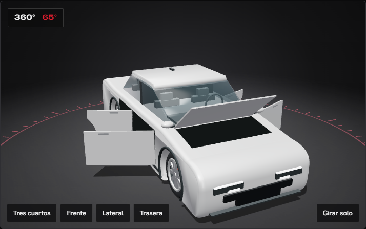
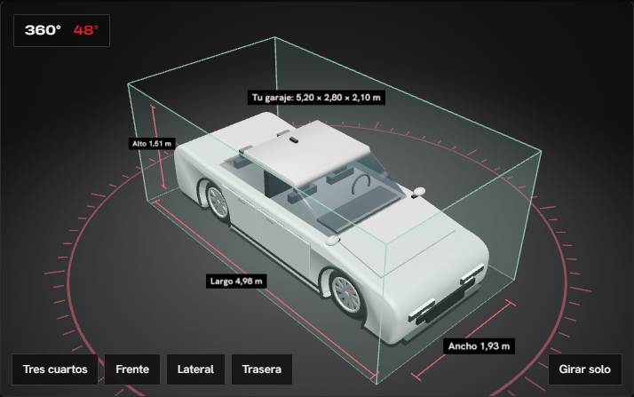
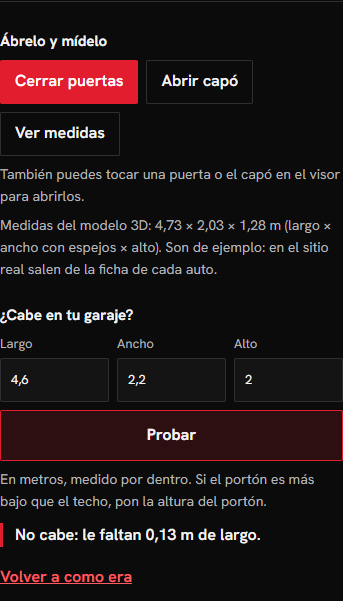

# Estudio 3D: abrir, medir y probar el garaje

Rama `estudio-3d`, 12/11/2026. Lleva al visor del concesionario la funcionalidad del estudio 3D de **Garajeo** (el proyecto de venta de garaje). Allá cada puerta en venta se arma con sus medidas reales, se abre, se le cambia el color y se prueba si entra en la abertura de tu casa. Acá lo mismo, con autos y garajes.

## Qué puede hacer el visitante

En el modo **Modelo 3D**, debajo de los botones de WhatsApp y prueba de manejo, aparece el bloque **«Ábrelo y mídelo»**:

| Función | Cómo se usa | Qué ve |
| --- | --- | --- |
| Abrir puertas | Botón «Abrir puertas», o tocar una puerta en el visor | Las puertas giran sobre su bisagra delantera; adentro se ven los asientos |
| Abrir capó | Botón «Abrir capó», o tocar el capó | La tapa se levanta desde el pie del parabrisas |
| Ver medidas | Botón «Ver medidas» | Cotas de largo, ancho (con espejos) y alto dibujadas sobre el piso, con su cartel |
| ¿Cabe en tu garaje? | Largo, ancho y alto en metros, y «Probar» | El garaje dibujado alrededor del auto, en verde, ámbar o rojo, y una frase con lo que sobra o falta |
| Color libre | El círculo de colores al lado de las muestras | Cualquier color, además de los 6 de fábrica |
| Volver a como era | Enlace al final del bloque | Cierra todo, saca las medidas y el garaje, y repone el color original |

Si el visitante está en «Fotos reales» y toca cualquiera de estos botones, el visor pasa solo a «Modelo 3D». En las motos no aparecen los botones de puertas ni capó. Si el navegador no puede mostrar 3D, el bloque no aparece.

### Las tres respuestas del garaje

- **Cabe** (verde): «Cabe. Te sobran 0,22 m de largo, 0,87 m de ancho y 0,59 m de alto.»
- **Cabe, pero justo** (ámbar): entra, pero quedan menos de 60 cm de ancho libre. Esos 60 cm son una estimación de lo que hace falta para abrir la puerta del conductor y bajarse; no es una norma. En las motos no se aplica.
- **No cabe** (rojo): dice cuánto falta y en qué medida.

Si escriben centímetros (520 en vez de 5,20) o dejan un campo vacío, la página lo dice en vez de dibujar algo absurdo. Se aceptan comas y puntos.

## Cómo está hecho

Todo está en `index.html`, con el mismo three.js r128 que ya usaba la página. No se agregaron dependencias ni archivos de código.

### 1. Puertas y capó dentro del modelo (`buildCar`)

Antes, las puertas eran solo líneas dibujadas sobre la carrocería. Ahora cada una es una pieza propia:

- **Corte:** se usan las mismas posiciones donde estaban las líneas (`cortes`), así que el auto cerrado se ve como antes.
- **Forma:** es una `Shape` extruida de 3 cm. El borde de abajo se calcula punto por punto para **rodear el paso de rueda** (función `piso`); sin eso, la puerta trasera de la SUV tapaba media rueda.
- **Bisagra:** la puerta cuelga de un `Group` ubicado en su borde delantero. Abrirla es girar ese grupo en el eje vertical, hasta 66°.
- **Hueco:** detrás de cada puerta hay un panel negro (`huecoMat`) que solo se ve al abrir. Del lado de adentro de la hoja hay un forro oscuro (`forroMat`).
- **Manijas:** las manijas cromadas ahora van montadas en la puerta y se mueven con ella.
- **Capó:** es una tapa apoyada sobre la línea del capó del perfil, con la bisagra al pie del parabrisas. Abajo tiene su propio hueco negro.

Cada pieza que se abre queda registrada en `g.userData.partes` con su ángulo actual (`act`), su ángulo objetivo (`obj`) y el máximo. Es el mismo patrón de Garajeo: la interfaz cambia el objetivo y el bucle de dibujo acerca el valor actual con suavidad. Con «reducir movimiento» activado en el sistema, se abre de golpe.

### 2. Medidas reales del modelo (`medirAuto`)

Las medidas no están escritas a mano: se miden del modelo con `Box3`, con las puertas cerradas. El ancho incluye los espejos, que es lo que importa para un garaje.

La moto se dibuja agrandada 1,55 veces para que se vea bien en el visor. Las medidas se dividen por esa escala, y el garaje se dibuja multiplicado por ella, así que el dibujo y los números siempre coinciden.

Las medidas actuales son las de los modelos genéricos (por ejemplo, el Halcón GT da 4,73 × 2,03 × 1,28 m). La página lo aclara al visitante.

### 3. Cotas y garaje (`dibujarCotas`, `dibujarGaraje`)

- **Cotas:** son líneas con topes y un cartel hecho con un `canvas` convertido en `Sprite`, siempre de frente a la cámara. Es la misma técnica de las cotas de Garajeo.
- **Garaje:** tiene tres paredes semitransparentes (el fondo y los dos costados; el frente queda abierto, como el portón), las aristas marcadas y un cartel con las medidas. El color sale del veredicto.
- **Grupo `estudio`:** todo esto vive en un grupo aparte de la escena. Así se oculta al generar las 36 fotos de ejemplo del modo «Fotos reales» y esas fotos no salen con cotas.
- **Cambio de auto:** al cambiar de auto con el garaje puesto, se vuelve a medir y el veredicto se recalcula solo.

### 4. Tocar para abrir (`enlazarToque`)

OrbitControls ya usa el arrastre para girar, así que un toque se distingue de un arrastre por dos condiciones: el dedo se movió menos de 6 px y el toque duró menos de medio segundo. En ese caso un `Raycaster` busca qué pieza se tocó, sube por sus padres hasta encontrar una con `userData.parte` y la abre o la cierra. El vidrio se atraviesa, para que se pueda tocar una puerta a través de la ventana.

## De Garajeo al concesionario: qué se tomó y qué se adaptó

| En Garajeo (`venta-garaje/prototipos/js/puerta3d.js`) | En el concesionario |
| --- | --- |
| Una puerta con bisagra que se abre con un deslizador o tocándola | Dos o cuatro puertas y el capó, con botones o tocándolos |
| Medidas en centímetros, escritas en el modelo | Medidas en metros, medidas del modelo con `Box3` |
| «¿Entra en tu abertura?»: pared con el hueco, rosa si no entra | «¿Cabe en tu garaje?»: tres paredes, verde, ámbar o rojo |
| Margen: marco de chapa y juego | Margen: 60 cm para abrir la puerta y bajarse (estimado) |
| Paleta de 8 colores y color libre | Los 6 colores de fábrica que ya había y color libre |
| Cámara propia con órbita a mano | Se mantuvo el OrbitControls que ya tenía la página |
| Voseo («Probá», «Mirala») | Tuteo, como el resto de la página («Prueba», «Ábrelo») |

**No se trajo:**
- **Marcas de uso y cambiar el lado de las bisagras:** en un auto no tienen sentido.
- **El deslizador de grados:** con tres o cinco piezas, un botón por grupo y el toque directo son más claros.

## Proceso seguido

1. **Elegir dónde.** Había dos proyectos de autos: este y Giro 360 (Next.js). Se eligió este porque ya tenía un visor three.js con autos hechos por código, así que la funcionalidad encajaba sin cambiar de tecnología.
2. **Leer el original.** Se recorrió `puerta3d.js` de Garajeo y se separó lo general de lo propio de las puertas. Lo general es el estado con objetivo y valor actual, las piezas con bisagra, las cotas con sprites, la prueba de medidas contra un espacio y el color libre.
3. **Leer el destino.** Se revisó cómo `buildCar` arma cada carrocería (el perfil extruido, las líneas de las puertas y los pasos de rueda) para cortar las puertas donde ya estaban dibujadas.
4. **Portar en una rama** (`estudio-3d`), sin tocar `main`.
5. **Probar.** Primero en el navegador integrado; después con Playwright, en Chrome a 1280 px y a 375 px:
   - abrir y cerrar con los botones y tocando el auto;
   - las tres respuestas del garaje, los centímetros por error y los campos vacíos;
   - cambiar de auto con el garaje puesto;
   - la moto sin puertas;
   - el color libre;
   - «Volver a como era»;
   - el paso desde «Fotos reales»;
   - la página sin WebGL;
   - que nada se salga del ancho;
   - que los botones midan 44 px.
6. **Arreglo de paso.** En celular, el visor medía 400 px en una pantalla de 375 px y la página se movía de costado. El problema ya estaba en la versión publicada: la altura mínima con proporción 4:3 forzaba el ancho. Se corrigió con `width:100%` en `.stage`.

## Pendiente

- **Medidas reales:** cuando haya autos reales, sus medidas deberían salir de la ficha del fabricante, no del modelo genérico. El campo ya existe en el código: basta con reemplazar `dims` por los datos de la ficha.
- **Los 60 cm del «justo»:** son una estimación. Si el concesionario usa otro criterio, se cambia en `veredicto`.
- **Sin publicar:** el cambio no está en `main` ni en GitHub Pages; está en la rama `estudio-3d`.
